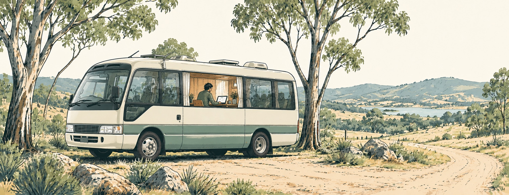
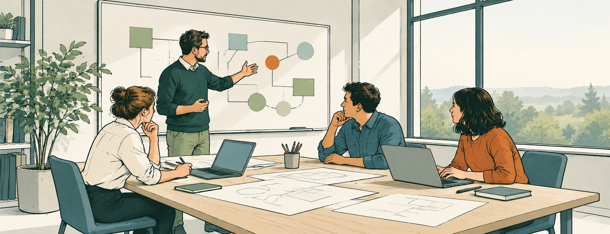

# Hi, I'm Dani.

**I lead engineering teams and keep building.** Today, that means financial technology used by major banks across MENA, and AI-assisted engineering systems.

## Research in the open

My path started in Milan, studying Computer Engineering at Politecnico di Milano. In Oulu, I moved into research on interactive public displays and multiuser interfaces. The software lived in shared spaces around the city, where several people could use the same display. Alongside the interfaces, I worked on real-time communication and mixed-reality projects that brought collaborative storytelling into shared physical spaces.

  

A question from the early research

What changes when an interface moves from a personal tablet to a wall-sized public display? One project at the University of Oulu explored that transition, taking a 3D city interface from a private screen to a shared one.

## Products and a life abroad

London brought a move into commercial product engineering. I worked on research-information software, then products in news and travel. At Trainline, that meant software for planning and booking a train journey, connecting what people saw on screen with the services behind it.

In Sydney, I joined Atlassian and became a Principal Engineer, working on Jira. During my final year in Australia, I lived and worked from a converted bus while travelling through New South Wales.

  

## Building teams and systems

In the UAE, first in Dubai and then Abu Dhabi, my work grew to include engineering leadership in banking and wealth technology. I've built an engineering organisation from its first hire and led teams delivering production platforms.

That responsibility spans the people doing the work and the software they ship. Hiring and helping engineers grow sit alongside technical direction and delivery. I stay involved in the engineering while helping teams take on more ambitious work.

  

There is room for smaller experiments too. Physics and music meet in [Musical Planets](https://syymza.github.io/musical-planets/), a little instrument that turns orbits into melodies. I still enjoy making something simply to see how it works.

[More of my story →](https://syymza.github.io/)
