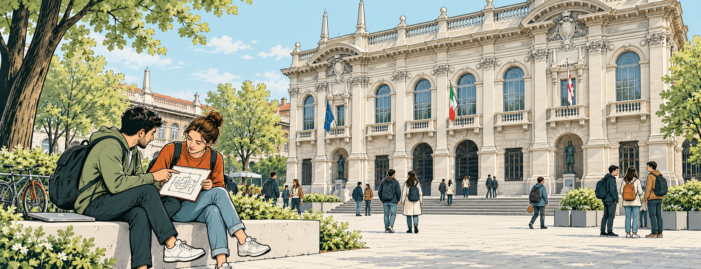
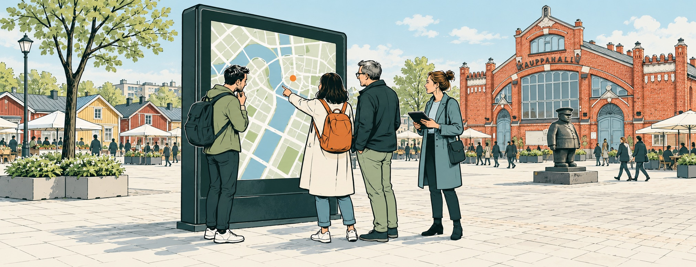
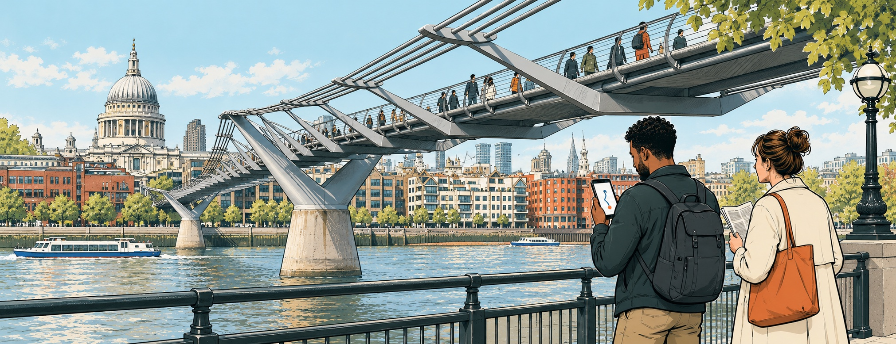
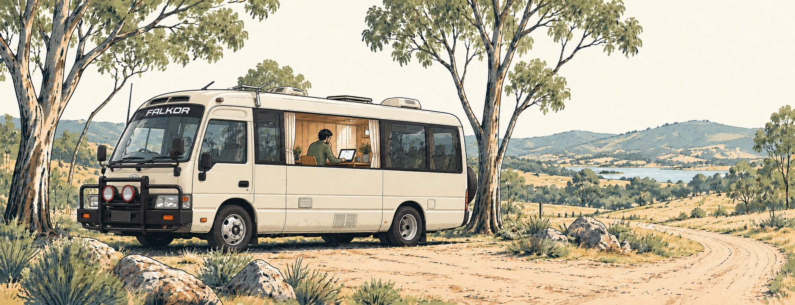
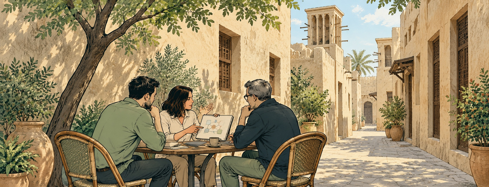
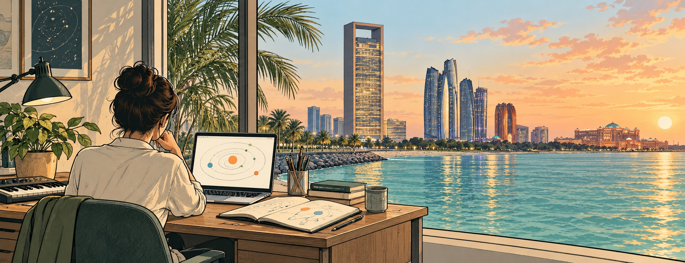

# Hi, I'm Dani.

**I lead engineering teams and keep building.** Today, that means financial technology used by major banks across MENA, and AI-assisted engineering systems. My path here runs through six places I've called home, with a different kind of building in each chapter.

## Milan · Learning how things work

I grew up in Milan and studied Computer Engineering at Politecnico di Milano. I completed a BSc there, with a thesis on tag-based file systems.

  

## Oulu · Interfaces out in the world

I moved to Oulu, Finland, where I continued studying at the University of Oulu and worked on interactive public displays and multiuser interfaces deployed around the city. One project took a 3D city interface from a personal tablet to a wall-sized display, moving from individual use to a shared experience.

Alongside the interfaces, I worked on real-time communication and mixed-reality projects that brought collaborative storytelling into shared physical spaces.

  

## London · Software for everyday life

London brought a move into commercial product engineering. I worked on research-information software, then products in news and travel. The settings changed, but the work kept bringing together what people saw on screen and the services behind it.

At Trainline, that meant software for planning and booking a train journey. My work across these years spanned interfaces, APIs and delivery automation, with hands-on engineering alongside technical leadership.

  

## Sydney · Building, with room to roam

In Sydney, I joined Atlassian and became a Principal Engineer, working on Jira. That chapter centred on software people use to organise their own work, and on engineering within a large, established product.

Life outside the role took an unusual shape too. During my final year in Australia, I lived and worked from a converted bus while travelling through New South Wales. A laptop, a much smaller home and a changing view became part of the same working life.

  

## Dubai · Engineering through people

Dubai brought a move into banking engineering leadership. My responsibilities grew to include technical direction, quality and helping engineers develop, alongside the systems themselves. I stayed close to the engineering while helping others take on more responsibility, a balance that continues in my work today.

  

## Abu Dhabi · Teams, systems and the next idea

Abu Dhabi is home now. I've built an engineering organisation from its first hire and led teams delivering production platforms in banking and wealth technology. Hiring and helping engineers grow sit alongside technical direction and delivery. I still build, including AI-assisted engineering systems, while helping teams take on more ambitious work.

I still make small things just to see how they work: [Orbit](https://syymza.github.io/musical-planets/), where orbits become melodies; [A Second Shape](https://syymza.github.io/a-second-shape/), where turning sculptures reveals animals in shadow; and [The Sleepy Tenant](https://syymza.github.io/the-sleepy-tenant/), a shy creature in a ceramic cup that reacts as you move its saucer. Small experiments in physics, perception and play.

  

[More of my story →](https://syymza.github.io/)
